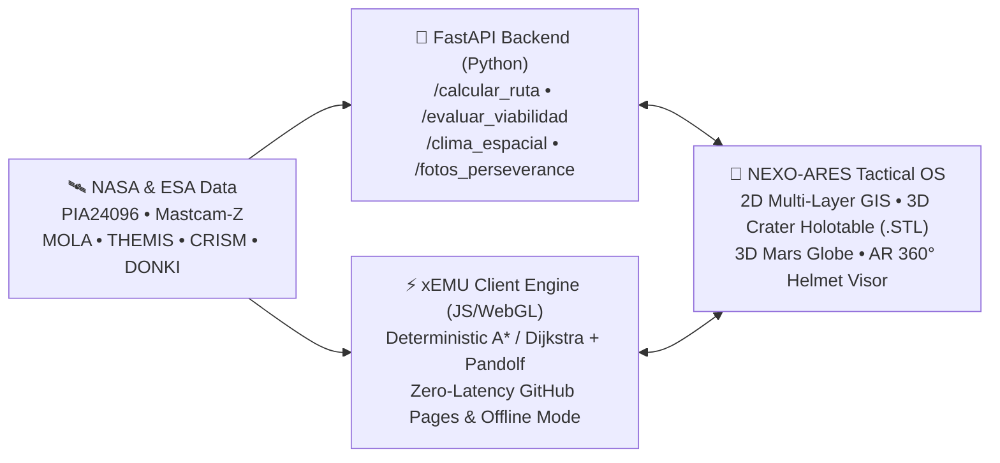

# 🛰️ NEXO-ARES — Astronaut Routing & EVA Survival System for Jezero Crater

[](https://www.spaceappschallenge.org/)
[](https://ortiz10m.github.io/nexo-code-nass/frontend/index.html)
[](https://ortiz10m.github.io/nexo-code-nass/frontend/slides.html)
[](#)

> **"NASA Mars Trek was built to view Mars from a desk on Earth; NEXO-ARES was built to keep the first human astronaut alive while walking across Jezero Crater."**  
> **Location:** Neiva, Huila, Colombia 🇨🇴 • **Team Nexo Code:** David Santiago Ortiz Rincon, Samuel Esteban Ramirez, Daniel Zea Tamayo, Mailyn Yuliana Rojas, Diego Fernando Vargas Ramirez.

---

## 🌐 Live Public Links (Zero Login / Zero Password Required)
* **🚀 Live Tactical EVA Application:** [https://ortiz10m.github.io/nexo-code-nass/frontend/index.html](https://ortiz10m.github.io/nexo-code-nass/frontend/index.html)
* **📊 Official 7-Slide Mission Briefing (`EN / ES`):** [https://ortiz10m.github.io/nexo-code-nass/frontend/slides.html](https://ortiz10m.github.io/nexo-code-nass/frontend/slides.html)
* **💻 Full Source Code Repository:** [https://github.com/ortiz10m/nexo-code-nass](https://github.com/ortiz10m/nexo-code-nass)

---

## 🎯 1. Executive Summary (The Problem & Our Solution)
Traditional planetary GIS portals (such as NASA Mars Trek) display geological imagery and elevation, but **they do not know what a human astronaut is**. Tracing a straight line across Jezero Crater ignores four lethal hazards that have ended real NASA robotic missions:
1. **Unstable Slopes (`> 20°`):** In 2009, the *Spirit* rover was lost forever in soft sloped regolith at Gusev Crater. A human astronaut wearing a pressurized **NASA xEMU suit** (`137 kg` Earth mass / `52 kg` Mars weight) risks fatal falls and suit fabric puncture on talus slopes above `20°` (such as *Kodiak Butte* at `23.6°`).
2. **Metabolic PLSS Oxygen Depletion (`< 30%` Reserve):** In 2018, *Opportunity* died from energy depletion during a global storm. Human EVAs require strict metabolic `O₂` accounting and an unbreakable **30% NASA emergency reserve** (*Bingo O₂*).
3. **UHF Line-of-Sight Radio Blackouts:** Deep impact craters like *Belva Crater* (`-2,615 m`, `21.8°` walls) block direct UHF radio line-of-sight with the *Octavia E. Butler* Habitat Base.
4. **Solar Particle Events (CMEs) & Human-Only Science:** Coronal Mass Ejections tracked by **NASA DONKI** spike surface radiation from `0.028 mSv/h` to `0.85 mSv/h`. Furthermore, when *Ingenuity* broke its rotor blade on **Flight 72** at *Valinor Hills* (Jan 2024), *Perseverance* could not approach due to steep dunes—requiring a human EVA recovery mission modeled after **Apollo 12 / Surveyor 3**.

---

## ⚙️ 2. Dual-Engine Hybrid Architecture (Cloud API + Client Bunker Engine)

**NEXO-ARES** features a **Dual-Runtime Hybrid Architecture** so it works both as a full Python microservice and as an instant, zero-latency browser system on GitHub Pages or offline in the field:



---

## 🔬 3. White-Box Mathematical & Biomedical Engine

Unlike "black-box" AI wrappers that hallucinate numbers, **NEXO-ARES** computes every traverse using four peer-reviewed physical and physiological equations auditable live via the **`🔬 White-Box`** modal:

### 1. Martian Spherical Haversine Geodesy ($R_{\text{Mars}} = 3,396.19\text{ km}$)
$$d = 2 \cdot R_{\text{Mars}} \cdot \arcsin\left(\sqrt{\sin^2\left(\frac{\Delta\phi}{2}\right) + \cos(\phi_1)\cos(\phi_2)\sin^2\left(\frac{\Delta\lambda}{2}\right)}\right)$$

### 2. Pandolf (1977) & Langmuir (1938) Metabolic Expenditure in Martian Gravity ($g = 3.721\text{ m/s}^2$)
$$\text{kcal}_{\text{segment}} = d_{\text{km}} \cdot 90 \cdot \left(1 + \left(\frac{\theta_{\text{deg}}}{10}\right)^{1.7}\right) \cdot f_{\text{payload}}$$
$$\text{O}_{2\text{ required (\%)}} = \frac{\sum \text{kcal}}{3600} \times 100, \quad \text{Liters O}_2 = \sum \text{kcal} \times 0.21$$
* **3 Operational Mobility Modes:**
  * `🏃 Light EVA (0 kg extra)`: Fast reconnaissance walk.
  * `🧑‍🚀 NASA xEMU Suit (+12 kg sample kit)`: Standard geological EVA; locks slopes `> 20°` and enforces `≥ 30%` final `O₂` reserve.
  * `🚙 Pressurized Rover Support`: Reduces astronaut metabolic `O₂` consumption by **45%** (`f_payload = 0.55`) and triples safe exploration range.

### 3. Martian UHF Horizon & Line-of-Sight Link
$$d_{\text{horizon}} = \sqrt{2 \cdot R_{\text{Mars}} \cdot h_{\text{antenna}}}$$
Automatically penalizes and reroutes around deep craters (*Belva Crater*) that sever UHF telemetry with the Habitat.

### 4. Cumulative Ionizing Radiation Dose (NASA DONKI)
$$D_{\text{EVA}} = \left(\frac{t_{\text{min}}}{60}\right) \cdot \dot{D}_{\text{DONKI}}\ (\text{mSv/h})$$
Triggers an immediate **EVA Abort & Shelter Protocol** if a simulated or live S3 Solar Storm (`0.85 mSv/h`) pushes cumulative dose toward safety limits.

---

## 🖥️ 4. Core Modules & Interactive Capabilities

| Module | What It Does | Key Controls |
| :--- | :--- | :--- |
| **🗺️ 2D Tactical GIS + 7 Orbital Layers** | Compares **Recommended Safe Route (`A*`)** vs. **Direct Crater Shortcut** with a live green/red `O₂` autonomy ring and MOLA SVG elevation profile (`.CSV` export). | `🛰️ Layers ▾`: *HD Satellite (5m/px)*, *Viking Color*, *MOLA Elevation*, *MOLA 40% Fusion*, *THEMIS Thermal Inertia*, *CRISM Biosignatures*, *EVA Hazard Zones*. |
| **🏔️ 3D Circular Crater Holotable + `.STL`** | WebGL/Three.js `128×128` squircular holographic table built from real luminance photogrammetry of `PIA24096` + MOLA altimetry. | `☀️ Sun (06:00–18:30)` lateral shadows, `🌈 Real vs. MOLA X-Ray` comparator, `📡 Pulse [Space]` sonar, and **1-click `.STL` export** for 3D printing. |
| **🧑‍🚀 AR 360° Helmet Visor (Street View)** | First-person astronaut helmet HUD using seamless 360° **Mastcam-Z** panoramas with live compass bearings (`N/NE/E/SE/S/SW/W/NW`). | Click **`🔬 PIXL / SuperCam`** reticle to laser-scan rock mineralogy, toggle **`🔊 EVA Audio`** (Web Audio synthesized breathing & Martian wind), and inspect raw NASA site frames. |
| **🪐 3D Planetary Mars Globe** | Global orbital context with a 2,600-star rotating cosmos comparing 5 NASA landing sites and their engineering lessons. | Color-coded laser beacons: *Perseverance* (Green), *Curiosity* (Blue), *InSight* (Yellow), *Spirit* & *Opportunity* (Red NO-GO lessons). |
| **⚡ Live Chaos Test & 📋 Cuff Checklist** | Injects real-time mission emergencies and generates an **Apollo/Artemis-style printable wrist checklist**. | Simulate `-35% Suit O₂ Leak`, `0.85 mSv/h CME Storm`, or `UHF Blackout`; press **`Esc`** anytime for instant Safe Reset. |

---

## 📍 5. The 13 Real Jezero Crater Nodes (`puntos_interes.json`)

| ID | Geological Site | Lat / Lon | Elev (m) | Slope | UHF | Operational Role & Scientific Target |
| :-: | :--- | :---: | :---: | :---: | :-: | :--- |
| **1** | **Octavia E. Butler Base (Habitat)** | `18.4447°N, 77.5200°E` | `-2,570` | `1.8°` | ✅ | Primary landing zone, pressurized habitat & UHF relay. |
| **2** | **South Séítah Region (Dunes)** | `18.4050°N, 77.4650°E` | `-2,585` | `9.4°` | ✅ | Olivine & carbonate outcrops; igneous dating. |
| **3** | **Santa Cruz Hill** | `18.3750°N, 77.4050°E` | `-2,540` | `14.2°` | ✅ | Elevated radar triangulation & eolian vantage point. |
| **4** | **Kodiak Butte (Delta Scarp)** | `18.3850°N, 77.3350°E` | `-2,495` | **`23.6°`** | ✅ | **⛔ LOCKED (>20° xEMU slope limit)**; ancient delta remnant. |
| **5** | **Three Forks Sample Depot** | `18.4580°N, 77.4520°E` | `-2,562` | `4.5°` | ✅ | Flat safe corridor & Mars Sample Return titanium tube cache. |
| **6** | **Belva Crater (Deep Interior)** | `18.5080°N, 77.4250°E` | `-2,615` | **`21.8°`** | **📵** | **⛔ LOCKED (>20° slope + UHF shadow)**; exposes deep strata. |
| **7** | **Hogwallow Flats (Delta Front)** | `18.4450°N, 77.3750°E` | `-2,530` | `11.2°` | ✅ | **#1 Astrobiology target**; fine-grained mudstones & sulfates. |
| **8** | **Neretva Vallis (River Channel)** | `18.4980°N, 77.3150°E` | `-2,465` | `16.5°` | ✅ | Ancient inflow river canyon feeding the Jezero paleolake. |
| **9** | **Máaz Formation (Basalts)** | `18.5150°N, 77.5050°E` | `-2,555` | `5.2°` | ✅ | Vesicular basaltic lava floor for radiometric calibration. |
| **10** | **Artuby Ridge Dunes** | `18.3600°N, 77.5150°E` | `-2,590` | `12.8°` | ✅ | Compacted megadune ridge bordering South Séítah. |
| **11** | **Bright Angel (Cheyava Falls)** | `18.4480°N, 77.2980°E` | `-2,485` | `8.6°` | ✅ | Light-toned sulfate rocks & organic biosignature veins. |
| **12** | **West Jezero Rim (Overlook)** | `18.5280°N, 77.2450°E` | `-2,320` | **`24.5°`** | **📵** | **⛔ LOCKED (>20° extreme climb + UHF shadow)**. |
| **13** | **Valinor Hills (Ingenuity Flight 72)** | `18.4860°N, 77.3680°E` | `-2,490` | `13.5°` | ✅ | **Apollo 12-style human recovery** of broken rotor blade & batteries. |

---

## 📚 6. Official NASA & Partner Space Agency Resources Used
1. **NASA / JPL-Caltech / MSSS / USGS — Jezero Crater Base Orbital Mosaic (`PIA24096`):**  
   https://photojournal.jpl.nasa.gov/catalog/PIA24096
2. **NASA / JPL-Caltech / ASU — Perseverance Mastcam-Z & Navcam Surface Panoramas (`PIA25734`, `PIA24836`, `PIA25172`, `PIA25889`, `PIA25663`, `PIA26373`, `PIA26237`):**  
   https://mars.nasa.gov/mars2020/multimedia/raw-images/
3. **NASA MGS MOLA & MRO HiRISE — Digital Elevation Model (DEM) & Altimetry WMTS:**  
   https://trek.nasa.gov/mars/ & https://www.uahirise.org/
4. **NASA DONKI API (Space Weather Database Of Notifications, Knowledge, Information):**  
   https://api.nasa.gov/
5. **NASA Images & Video Library API:**  
   https://images.nasa.gov/
6. **ESA (European Space Agency) — Mars Express HRSC (High Resolution Stereo Camera):**  
   https://www.esa.int/Science_Exploration/Space_Science/Mars_Express

---

## 🤖 7. Synthetic Intelligence (SI / AI) Transparency Disclosure
* **How AI Tools Were Used:** Large Language Models (LLMs / code assistants) were used as pair-programming accelerators to structure the FastAPI client-server endpoints, optimize Three.js WebGL buffer geometries, and format bilingual (`EN/ES`) UI translations.
* **Strict NASA Brand & Data Integrity:** **Zero planetary images, panoramas, or scientific datasets were generated or altered by AI.** All textures and surface views are authentic, unmodified NASA/JPL-Caltech and ESA imagery. This project contains **zero NASA logos or restricted insignias**.

---

## ▶️ 8. Local Installation & Execution (Python FastAPI + Static Mode)
```bash
git clone https://github.com/ortiz10m/nexo-code-nass.git
cd nexo-code-nass
python -m venv venv
# Windows PowerShell:
.\venv\Scripts\activate
pip install -r backend/requirements.txt
uvicorn backend.main:app --reload --port 8000
```
* **Tactical EVA App:** `http://127.0.0.1:8000/app` (or open `frontend/index.html` directly)
* **7-Slide Mission Briefing:** `http://127.0.0.1:8000/slides` (or open `frontend/slides.html` directly)
* **Interactive Swagger API Docs:** `http://127.0.0.1:8000/docs`
